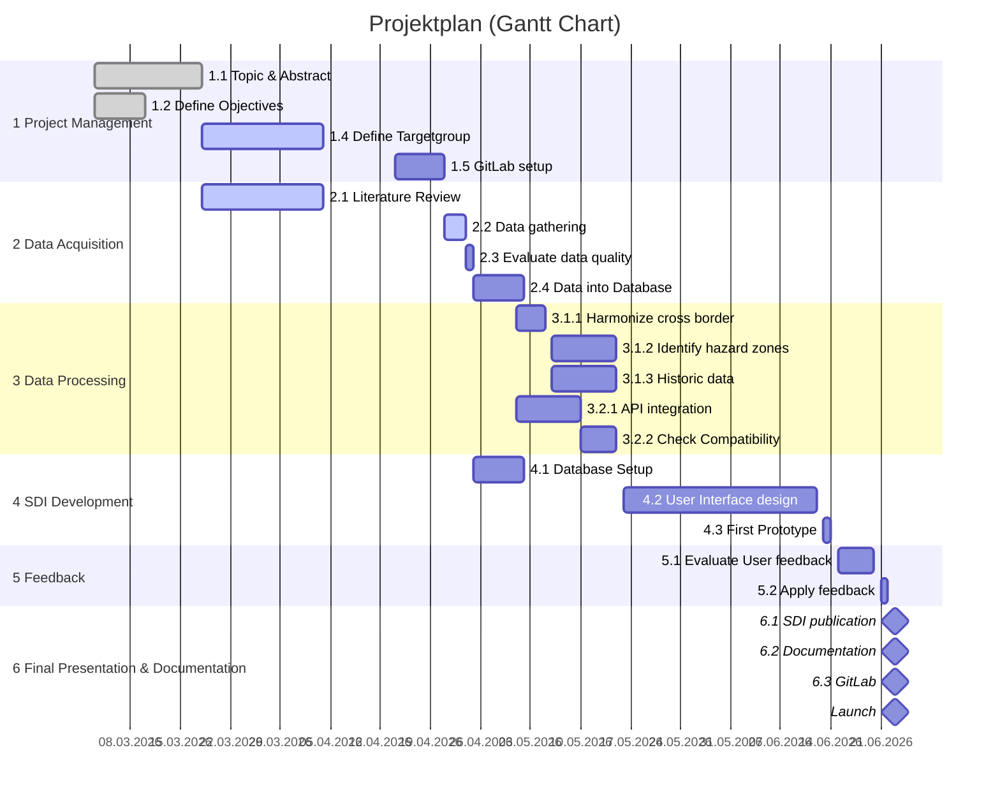

# SDI_IWS

Dashboard: https://schmlou.github.io/sdi_biwa/

## Mission Statement

This project is part of the Masters study program in "Applied Geoinformatics" and "Copernicus Master in Digital Earth" at the Z_GIS (Paris-Lodron University Salzburg). In the course "SDI Implementation" and the "GI/EO Project Management"-course support the planing and implementation of an SDI. The idea of creating an integrated warning system for the cross-border alpine region of "Berchtesgaden" and "Salzburger Land" was developed by the students.  

## Abstract

The Alpine Region, especially the transboundary area encompassing “Nationalpark Berchtesgaden” in Bavaria and the “Land Salzburg” in Austria, are high susceptible to natural hazards such as pluvial floods, landslides and avalanches. In topographically challenging regions, disaster risk management is frequently compromised by administrative differences, resulting in fragmented geospatial data, including incompatible coordinate reference systems, and different semantic definitions about hazard zones across national borders. This project aims to develop a transboundary SDI to harmonize, integrate and visualise critical disaster prevention and meteorological data. By using an open-source architecture to handle geometric harmonisation, including the grid shifts from the Austrian and German coordinate systems, and by adopting standards from the Open Geospatial Consortium (OGC) for publishing. This will make risk zones and topographic models, sourced from regional authorities such as SAGIS and LfU, publicly available. To elevate the system from a static map to a dynamic forecasting tool, SDI middleware (e.g. lightweight standards like OGC API Features) will incorporate high-resolution, real-time meteorological APIs provided by Deutscher Wetterdienst (DWD) and GeoSphere Austria (Austrian geological, geophysical, climatological and meteorological Service). The deliverable is an interactive, web-based decision support tool that combines cross-border data streams to provide a cross-border hazard map. By adhering to the FAIR principle, this will demonstrate an interoperable and scalable methodology for overcoming transboundary data fragmentation and enhance regional resilience against (climate-triggered) natural hazards.

### Keywords

Open-source, hazard map, harmonization

## Authors

Mary Muthee (MSc Copernicus Master in Digital Earth),
Louis Schmalisch (MSc Applied Geoinformatics),
Ullah Asad (MSc Applied Geoinformatics)

## Project plan

